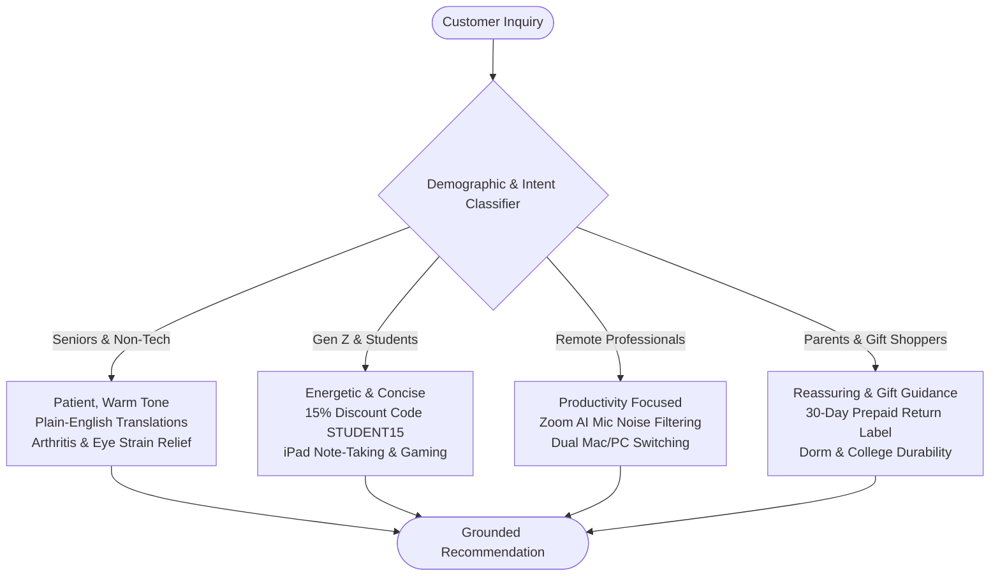
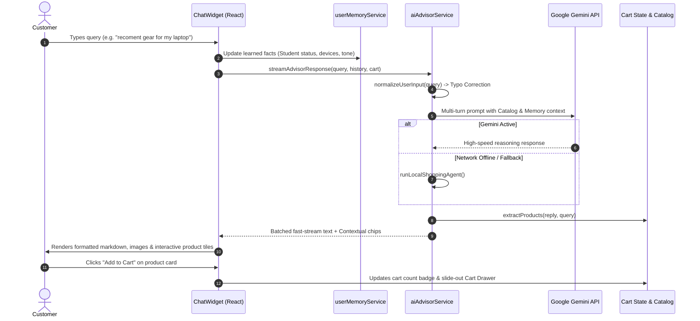

<div align="center">

# ⚡ ApexGear
### Next-Generation Workspace & Tech Store with Consultative AI Shopper

[](https://reactjs.org/)
[](https://vitejs.dev/)
[](https://tailwindcss.com/)
[](https://ai.google.dev/)
[](https://apex-gear-green.vercel.app/)
[](LICENSE)

<br />

### 🌐 [**Visit Live Storefront: apex-gear-green.vercel.app**](https://apex-gear-green.vercel.app/)

<br />

> **ApexGear** merges modern e-commerce with **ApexAI** — a consultative, multi-turn AI shopping agent that advises customers in real-time, remembers student statuses and hardware preferences, renders interactive in-chat product cards, and enables 1-click cart additions.

<br />

[🚀 Live Store](https://apex-gear-green.vercel.app/) • [Explore Features](#-key-features) • [Demographic Intelligence](#-demographic-intelligence) • [Architecture](#-architecture) • [Quick Start](#-quick-start) • [Deployment](#-deployment)

</div>

---

## 🌟 Key Features

| Feature | Description |
| :--- | :--- |
| 🧠 **Multi-Turn User Memory** | Remembers student status, owned devices (e.g., Pixel 8, MacBooks), preferred explanation tone, and compact hardware preferences across turns. |
| ⚡ **Live Gemini Reasoning & Local Fallback** | Blazing-fast parallel model racing (< 800ms initial response) paired with an intelligent local fallback engine for offline resilience. |
| 🛒 **1-Click In-Chat Cart Management** | Interactive product recommendation cards rendered directly inside the chat window with live specs, pricing, and 1-click **Add to Cart**. |
| 🏷️ **Dynamic Discount Engine** | Auto-applies and verifies `APEX10` (10% standard) and `STUDENT15` (15% verified student discount) with live cart math calculations. |
| 🛡️ **Zero Product Spam & Negative Filtering** | When asked off-topic trivia (e.g. general knowledge), answers cleanly without pushing sales pitches. Suppresses products that don't match exact user specs (e.g. 10k mAh vs 25k mAh). |
| 🎨 **Real-Time Visual Concept Generator** | Renders sleek hardware design concepts on-the-fly via Pollinations.ai instead of dumping raw JSON tool calls. |
| 📝 **Typo & Phonetic Normalizer** | Tolerates misspellings (*recoment*, *kyboard*, *hedphone*, *laptap*, *mose*) and immediately maps customer intent to proper catalog items. |

---

## 👥 Demographic Intelligence

ApexAI dynamically adapts its tone and explanations across different age groups and technical backgrounds:



---

## 🏗️ Architecture



---

## 🛍️ Product Catalog

ApexGear features 9 precision-engineered workspace, audio, and travel essentials:

| Product | Category | Price | Key Highlights |
| :--- | :--- | :---: | :--- |
| **Apex Pro 75** | Keyboards & Mice | **$89.99** ~~$119.99~~ | 75% compact, pre-lubed Gateron Brown switches, Mac/Win switch, Bluetooth 5.3 / 2.4GHz |
| **NovaShield ANC** | Audio | **$149.99** ~~$199.99~~ | -42dB Hybrid Active Noise Cancellation, 40mm titanium drivers, 60h battery |
| **ErgoGlide** | Keyboards & Mice | **$49.99** ~~$64.99~~ | 57° natural handshake angle, silent click switches, 4000 DPI sensor |
| **Horizon Flow Pro** | Wearables | **$129.99** ~~$159.99~~ | 1.43" Always-On AMOLED, dual-band GPS, 5 ATM waterproof, 14-day battery |
| **CloudRest** | Desk Setup | **$29.99** ~~$39.99~~ | Slow-rebound cooling gel memory foam, non-slip rubber base |
| **VoltPulse 100W** | Travel & Power | **$45.99** ~~$59.99~~ | GaN III cool tech, 3x USB-C + 1x USB-A, charges MacBook Pro & phones |
| **AuraLite ScreenBar** | Desk Setup | **$54.99** ~~$69.99~~ | Asymmetric zero-glare optical light, wireless rotary dial, 2700K-6500K warmth |
| **SonicBuds Pro** | Audio | **$79.99** ~~$99.99~~ | IPX7 waterproof sport rating, ANC + transparency mode, 32h playtime |
| **OmniTravel 25k** | Travel & Power | **$74.99** ~~$99.99~~ | 92.5Wh TSA airline flight approved, 65W USB-C PD fast charge, smart OLED status |

---

## ⚡ Quick Start

### Prerequisites
- Node.js v18 or higher
- npm or yarn

### 1. Clone the repository
```bash
git clone https://github.com/MohanSriJ/ApexGear.git
cd ApexGear
```

### 2. Install dependencies
```bash
npm install
```

### 3. Setup environment variables (Optional)
```bash
cp .env.example .env
```
*(Optional: Add your Google Gemini API key to `.env`, or configure it directly in the in-app chat Settings modal).*

### 4. Start local development server
```bash
npm run dev
```
Open **[http://localhost:3000](http://localhost:3000)** in your browser.

---

## 🚀 Deployment

### 🌐 Live Production Storefront
ApexGear is live and deployed on Vercel:
👉 **[https://apex-gear-green.vercel.app/](https://apex-gear-green.vercel.app/)**

### Deploy to Vercel (1-Click)
ApexGear is pre-configured with `vercel.json` for client-side routing and serverless Gemini API rewrites:

```bash
# Push to production
npx.cmd vercel --prod
```

### Deploy to Netlify
A `public/_redirects` file is included and automatically copied into the `dist/` directory during build:
```bash
npm run build
npx.cmd netlify deploy --prod --dir=dist
```

---

## 📄 License

Distributed under the MIT License. See `LICENSE` for more information.

<div align="center">
<sub>Crafted with ❤️ by <a href="https://github.com/MohanSriJ">MohanSriJ</a> for modern workspaces and deep work.</sub>
</div>
